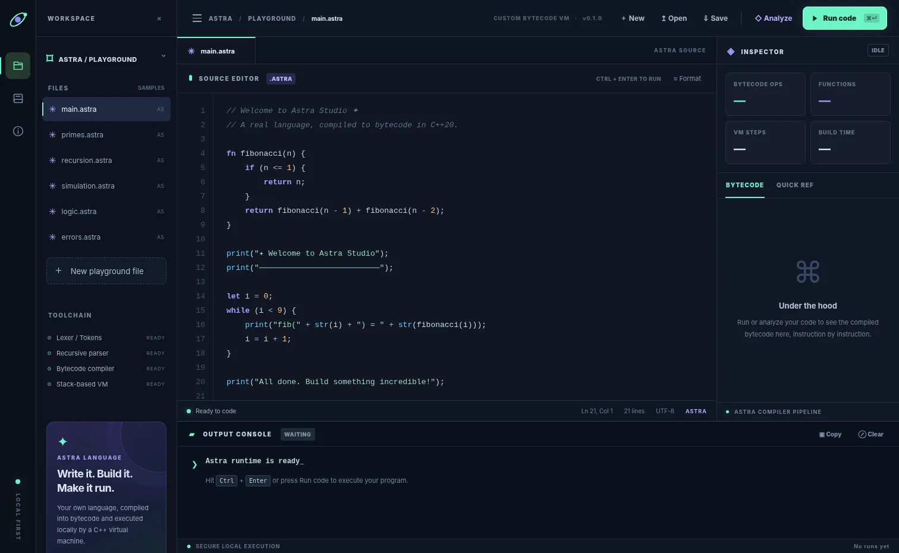

# Astra Studio

**A local-first, visual IDE for an experimental programming language, bytecode compiler and virtual machine written in C++20.**



Astra Studio is a functional proof-of-concept of a language toolchain: lexer → recursive-descent parser → AST → compiler → bytecode → stack VM. Its browser-based graphical user interface is served **only on your machine** by a small C++ HTTP server. There is no hosting, online account, API key or JavaScript language interpreter: user-written programs execute in the C++ VM.

> **Scope:** This repository contains the functional v0.1 foundation of a long-term language/tooling project. Building a production general-purpose language, optimizing compiler, debugger and ecosystem would require years of additional engineering. This project does **not** claim to be production-ready or equivalent to LLVM, VS Code, or a secure sandbox.

## Features

- Custom dark-mode visual IDE: code editor, syntax highlighting, line numbers, cursor position, example programs, output console and bytecode inspector
- Real compiler and bytecode virtual machine written in C++20 (not a JavaScript emulator)
- AST parsing, operator precedence, arithmetic, comparisons, `&&`/`||` short-circuit, assignment
- Strings, numbers, booleans and `null`, local and global variables, lexical local scopes
- Functions, return values, forward references, recursive calls, `if/else` and `while`
- Built-ins: `print`, `len`, `str`, `sqrt`, `assert`
- Compilation without execution via **Analyze**
- Runtime and syntax errors with source line numbers
- Save and open `.astra` files; local browser autosave; local examples
- Hard caps on source size, execution steps, recursion depth and output
- CMake/CTest and continuous integration on Linux, Windows and macOS
- No third-party libraries or external runtime service

## Quick start

### Windows (Visual Studio 2022 / MSVC)

Requires **CMake >=3.20** and the **Desktop development with C++** workload (Visual Studio Build Tools or Visual Studio). Double-click `scripts/launch-windows.bat`, or build manually:

```powershell
cmake -S . -B build
cmake --build build --config Release
.\build\Release\astra-studio.exe
```

The `.exe` may instead be at `build\astra-studio.exe` depending on your CMake generator. Keep the generated `web` directory next to the executable.

### Linux

Requires CMake >=3.20 and a C++20 compiler (GCC 12+ or Clang 15+).

```bash
bash scripts/launch-linux.sh
```

Or:

```bash
cmake -S . -B build -DCMAKE_BUILD_TYPE=Release
cmake --build build --parallel
./build/astra-studio
```

### macOS

Requires Command Line Tools for Xcode and CMake >=3.20.

```bash
bash scripts/launch-macos.command
```

When the server starts, Astra Studio opens **http://127.0.0.1:4747/** in your default browser. If it doesn't open automatically, visit this address manually. The terminal process stays open while the app is running; stop it using **Ctrl+C**. You can override the port:

```bash
./build/astra-studio --port 5000 --no-browser
```

Astra Studio is a **visual local-web app**, not a packaged native GUI window. In v0.1 it runs a C++ backend and uses the browser for its interface. The IDE itself is not terminal-based, but a local process must stay running.

## Your first program

```astra
fn factorial(n) {
    if (n <= 1) {
        return 1;
    }
    return n * factorial(n - 1);
}

let i = 1;
while (i <= 8) {
    print(str(i) + "! = " + str(factorial(i)));
    i = i + 1;
}
```

Use **Run code** or **Ctrl+Enter**, or select **Analyze** to compile and inspect emitted opcodes without running the VM. See the built-in example files in the IDE and [`examples/`](examples/).

## Syntax at a glance

```astra
// Numbers, strings, booleans, and null
let a = 3.5;
let greeting = "Hello";
let active = true;
let nothing = null;

fn square(n) { return n * n; }
if (active && a > 2) { print(greeting + " " + str(square(a))); }

let i = 0;
while (i < 3) {
    print(i);
    i = i + 1;
}

assert(square(4) == 16);
```

The language is intentionally small. There are no arrays, classes, anonymous functions, modules, filesystem APIs or network APIs. `len(string)` currently counts **UTF-8 bytes**, not Unicode grapheme clusters.

## Architecture

```text
Web UI (HTML + CSS + JavaScript)
      |
      | POST /api/run        POST /api/analyze (plain UTF-8 source)
      v
Loopback-only C++ HTTP server (127.0.0.1:4747)
      |
      v
Lexer -> Tokens -> Recursive Descent Parser -> AST
                                            |
                                            v
                                        Compiler
                                            |
                                            v
                                        Bytecode
                                            |
                         +------------------+------------------+
                         |                                     |
                    Disassembler                           Stack VM
                                                               |
                                              Call frames / globals / output
```

- `include/astra/engine.hpp` — public engine interface
- `src/engine.cpp` — lexer, parser, AST, compiler, VM, disassembler
- `src/server.cpp` — cross-platform loopback-only HTTP server and asset serving
- `web/` — editor, inspector, console and local browser state
- `tests/` — CTest suite covering VM behavior and common error conditions
- `examples/` — language sample files
- `docs/` — architecture, language, and security documentation

Read [`docs/architecture.md`](docs/architecture.md) for instruction format and execution behavior.

## Test the engine

```bash
cmake -S . -B build -DCMAKE_BUILD_TYPE=Debug
cmake --build build --parallel
ctest --test-dir build --output-on-failure
```

GCC/Clang sanitizer builds:

```bash
cmake -S . -B build-asan -DASTRA_SANITIZERS=ON -DCMAKE_BUILD_TYPE=Debug
cmake --build build-asan --parallel
ctest --test-dir build-asan --output-on-failure
```

The test suite checks arithmetic, comparisons, functions, recursion, scopes, loops, logical short-circuiting, type errors, assertions, parser failures and VM limits. For an optional live API check while the server runs, use `python tests/smoke_http.py`. The GitHub Actions matrix also packages platform-specific executable artifacts after a successful build.

## Security and limitations

The server binds only to the loopback address and rejects unexpected host/origin headers for basic browser-request isolation. The runtime does not expose arbitrary filesystem or network operations to Astra code. Execution has limits of **128 KiB source**, **1,000,000 VM steps**, **256 call frames**, **1 MiB output**, **1 MiB concatenated strings** and **10,000 operand stack values**.

**Do not run untrusted or adversarial code in this v0.1 VM.** It is not an isolated process sandbox: an in-process interpreter can still have bugs, memory allocation spikes or performance hazards. HTTP implementation is designed for local personal use, not public internet deployment or multi-user service. See [`docs/security.md`](docs/security.md).

## Roadmap — from portfolio MVP to years-long engineering project

1. **Language 0.2:** arrays, maps, closures, lexical environments, object model, improved error recovery, source maps
2. **Development tools:** incremental parser, language-server protocol (LSP), autocomplete, hover types, breakpoints and time-travel debugger
3. **Runtime:** garbage collector, optimizations, tail calls, bytecode verifier, profiler, sandbox subprocess with resource limits
4. **Backend:** typed IR, SSA passes, control-flow graph, optional LLVM/native compilation, JIT, optimization benchmarking
5. **Ecosystem:** package manager, versioned module system, documentation generator, testing framework, REPL, standard library, distributable signed desktop installers

These features are **planned**, not implemented in v0.1.

## Portfolio description

> Built Astra Studio, a full-stack local IDE for a custom scripting language: implemented a lexer, recursive-descent parser, bytecode compiler, disassembler and stack-based virtual machine in C++20, with a visual browser UI, automated tests, and cross-platform CI.

## License

MIT. See [LICENSE](LICENSE).
